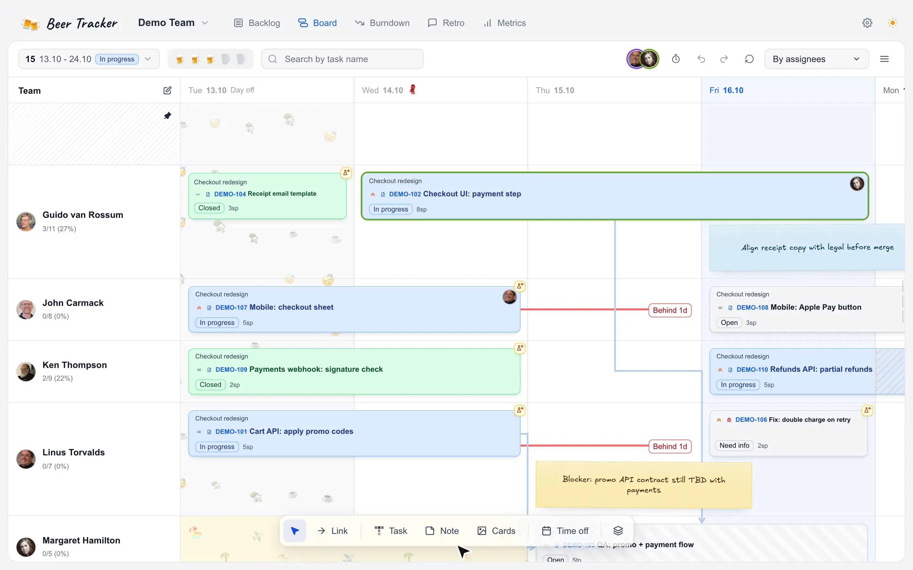
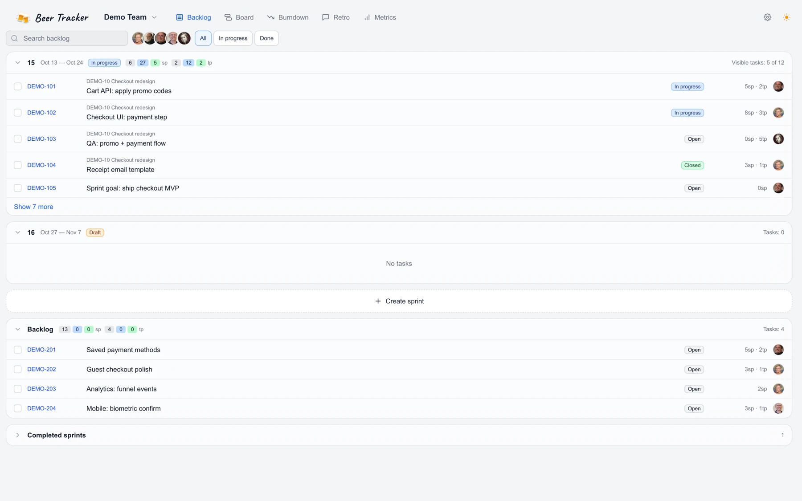
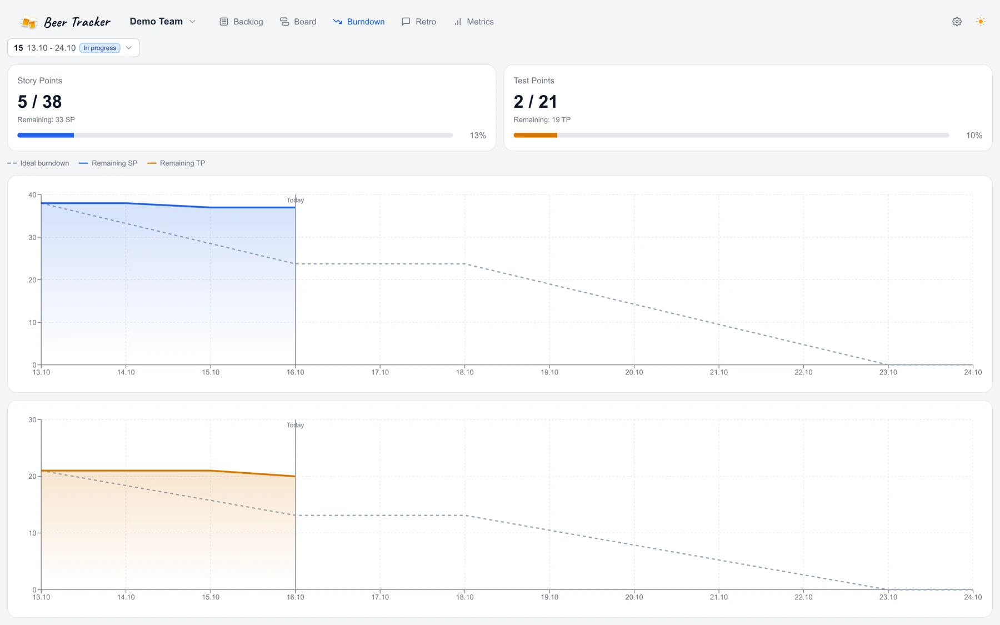
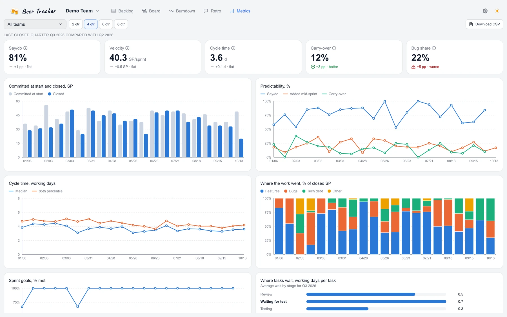
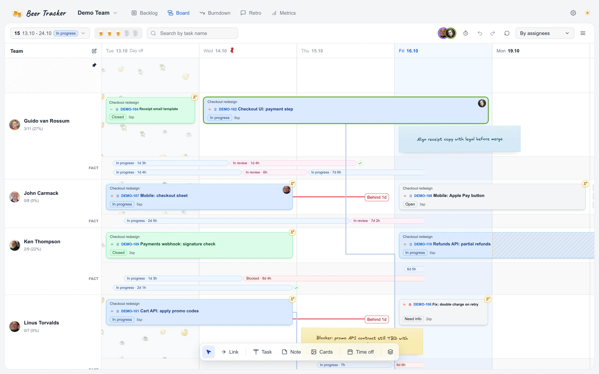
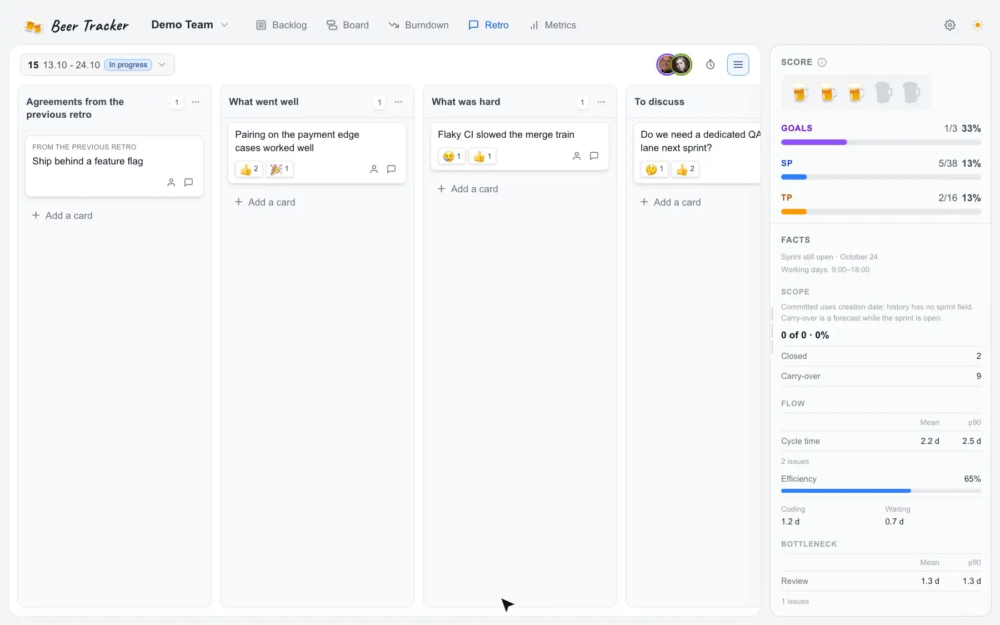
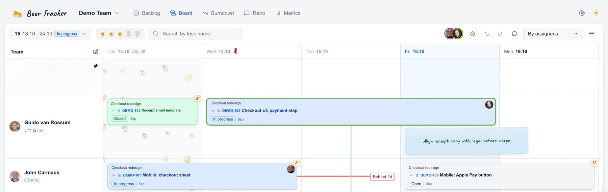

<h1 align="center">
  <picture>
    <source media="(prefers-color-scheme: dark)" srcset="./docs/media/logo-button-dark.png" />
    <source media="(prefers-color-scheme: light)" srcset="./docs/media/logo-button-light.png" />
    
  </picture>
</h1>

<p align="center">
  <a href="./README.md">Русский</a> · <strong>English</strong>
</p>

<p align="center">
  <strong>Sprint planner for Yandex Tracker and Jira</strong><br />
  Lay out work by person and day, groom the backlog, track goals and burndown. Your issues stay in your tracker.
</p>

<p align="center">
  <a href="./LICENSE"></a>
  <a href="https://hub.docker.com/r/dinkimom/beer-tracker"></a>
  <a href="./CHANGELOG.md"></a>
</p>

<p align="center">
  <a href="#planner">Planner</a> ·
  <a href="#backlog">Backlog</a> ·
  <a href="#burndown">Burndown</a> ·
  <a href="#metrics">Metrics</a> ·
  <a href="#fact-timeline">Fact timeline</a> ·
  <a href="#retro">Retro</a> ·
  <a href="#collaboration">Collaboration</a> ·
  <a href="#used-by">Used by</a> ·
  <a href="#quick-start">Start</a> ·
  <a href="#mcp-for-agents">MCP</a>
</p>

## Planner

The grid covers the sprint’s working days, taken from the tracker. Each day has 2, 3, or 4 slots (three by default), and every developer and tester gets their own lane.

You can view the board by person, by feature, or as a kanban by status. Cards arrange themselves into rows; turn off auto-arrange to place tasks and notes by hand, and the whole team sees that layout.

Drag a card to move it, or pull its edge to change the duration. Time off and tech sprints show up on the same lanes. The sprint’s issue list sits on the right.

<p align="center">
  <picture>
    <source media="(prefers-color-scheme: dark)" srcset="./docs/media/drag-resize-dark.webp" />
    <source media="(prefers-color-scheme: light)" srcset="./docs/media/drag-resize-light.webp" />
    
  </picture>
</p>

To link two tasks, pick the Link tool, click one card and then the other; the link is saved in the tracker.

<p align="center">
  <picture>
    <source media="(prefers-color-scheme: dark)" srcset="./docs/media/link-dark.webp" />
    <source media="(prefers-color-scheme: light)" srcset="./docs/media/link-light.webp" />
    
  </picture>
</p>

You can pin notes to the board as the sprint goes, so nothing slips; links, checklists, and reactions work inside them.

<p align="center">
  <picture>
    <source media="(prefers-color-scheme: dark)" srcset="./docs/media/note-dark.webp" />
    <source media="(prefers-color-scheme: light)" srcset="./docs/media/note-light.webp" />
    
  </picture>
</p>

## Backlog

Browse issues outside the sprint, filter by status and assignee, and pull them into the active sprint.

<p align="center">
  <picture>
    <source media="(prefers-color-scheme: dark)" srcset="./docs/media/backlog-dark.webp" />
    <source media="(prefers-color-scheme: light)" srcset="./docs/media/backlog-light.webp" />
    
  </picture>
</p>

## Burndown

Story points and test points per sprint day, with an ideal line and a marker for today.

<p align="center">
  <picture>
    <source media="(prefers-color-scheme: dark)" srcset="./docs/media/burndown-dark.webp" />
    <source media="(prefers-color-scheme: light)" srcset="./docs/media/burndown-light.webp" />
    
  </picture>
</p>

## Metrics

A dashboard for the board over 2 to 8 quarters: say/do, velocity, cycle time, carry-over and bug share, each compared with the previous quarter. Per-sprint charts below show committed versus closed points, where the work went and where tasks wait. You can filter by team and export to CSV.

<p align="center">
  <picture>
    <source media="(prefers-color-scheme: dark)" srcset="./docs/media/metrics-dark.webp" />
    <source media="(prefers-color-scheme: light)" srcset="./docs/media/metrics-light.webp" />
    
  </picture>
</p>

## Fact timeline

Sync pulls status history from the tracker and draws a **fact timeline** on the swimlane: when each issue was in progress, in review, and in test. It sits next to the plan rather than replacing it.

You start a sync from `/admin/sync`. Scheduled incremental sync needs Redis and `pnpm sync-worker`; a full rescan works without the worker. See [INSTALL.md](./docs/INSTALL.md) for details.

<p align="center">
  <picture>
    <source media="(prefers-color-scheme: dark)" srcset="./docs/media/fact-timeline-dark.webp" />
    <source media="(prefers-color-scheme: light)" srcset="./docs/media/fact-timeline-light.webp" />
    
  </picture>
</p>

## Retro

Columns, notes, images, comments, and reactions. The **Facts** side panel lists what was closed, added, dropped, and carried over, along with cycle time and bottlenecks from the changelog. Action items from the retro carry over into the next sprint.

<p align="center">
  <picture>
    <source media="(prefers-color-scheme: dark)" srcset="./docs/media/retro-dark.webp" />
    <source media="(prefers-color-scheme: light)" srcset="./docs/media/retro-light.webp" />
    
  </picture>
</p>

## Collaboration

When several people open the same sprint, you see who is on the board and what they are doing: avatars in the header and on cards, with the action next to them (viewing, moving, editing, resizing). While someone is dragging a card, it is locked for everyone else. Positions, issues, links, comments, and the retro update without a page reload. There is also a shared sprint timer.

If you run more than one instance, you need Redis. Without it, realtime only works within a single process.

<p align="center">
  <picture>
    <source media="(prefers-color-scheme: dark)" srcset="./docs/media/collaboration-dark.webp" />
    <source media="(prefers-color-scheme: light)" srcset="./docs/media/collaboration-light.webp" />
    
  </picture>
</p>

## Used by

Companies that run their sprints in Beer Tracker.

<!-- adopters: same order as docs/companies.md. Pair docs/media/companies/<id>-light.svg and <id>-dark.svg. -->
<p align="center">
  <a href="https://www.yclients.com">
    <picture>
      <source media="(prefers-color-scheme: dark)" srcset="./docs/media/companies/yclients-dark.svg" />
      <source media="(prefers-color-scheme: light)" srcset="./docs/media/companies/yclients-light.svg" />
      
    </picture>
  </a>
</p>

## Quick start

```bash
cp env.example .env
# POSTGRES_PASSWORD, AUTH_SESSION_SECRET (≥32), ORG_SECRETS_ENCRYPTION_KEY (64 hex)
docker compose -f docker-compose.yml -f docker-compose.hub.yml up -d
```

Open [http://localhost:3000](http://localhost:3000) and connect your tracker. Images are on Docker Hub as [`dinkimom/beer-tracker`](https://hub.docker.com/r/dinkimom/beer-tracker), tag `1.25.2`.

[docs/INSTALL.md](./docs/INSTALL.md) covers installation, S3, sync, and running from source. [docs/ISSUE_TRACKERS.md](./docs/ISSUE_TRACKERS.md) explains how to pick a tracker per organization.

## MCP for agents

The MCP server runs on your own instance. The client (Cursor, Claude Desktop, or Claude Code) opens a browser where you sign in and grant access, and then gets a Bearer token with the `mcp:tools` scope. See [SPRINT_CONTEXT.md](./docs/SPRINT_CONTEXT.md) for details.

The agent reads the plan and suggests changes, but nothing is written to the sprint until you confirm. It can:

- find a sprint (`search_sprints`) and load its planning graph: positions, capacity, goals, notes, links (`get_sprint_context`, `get_sprint_capacity`);
- find issues and people (`search_issues`, `resolve_person`) and open an issue or its snapshot;
- propose changes (`propose_plan_patch`) and apply them (`apply_plan_patch`);
- read and edit the retro board (`get_retro_board`, `apply_retro_board`).

| Prompt | What happens |
|--------|--------------|
| “What are the risks in sprint Demo 2615?” | The agent checks capacity and overlaps and briefly says who is overloaded |
| “Plan DEMO-101 for Alice” | The agent proposes positions and notes; a person reviews the preview and applies it |
| “Prepare the retro for Demo 2614” | The agent gathers the sprint’s facts and lays out draft cards on the retro board |

```json
{
  "mcpServers": {
    "beer-tracker-planning": {
      "url": "https://<your-bt-host>/api/mcp"
    }
  }
}
```

## Documentation

The guides below are in Russian.

| Document | What it covers |
|----------|----------------|
| [Install](./docs/INSTALL.md) | Docker, dev, env, sync |
| [Issue trackers](./docs/ISSUE_TRACKERS.md) | Yandex Tracker and Jira |
| [Capabilities](./docs/CAPABILITIES.md) | Full feature list |
| [Overview](./docs/PROJECT_OVERVIEW.md) | Who the product is for and which screens it has |
| [Sprint context / MCP](./docs/SPRINT_CONTEXT.md) | Planning graph and retro for agents |
| [Index](./docs/DOCUMENTATION_INDEX.md) | All documentation |

## Contributing

Commits need a [DCO](https://developercertificate.org/) sign-off (`git commit -s`); see [CONTRIBUTING.md](./CONTRIBUTING.md). Report vulnerabilities as described in [SECURITY.md](./SECURITY.md).

[ARCHITECTURE.md](./ARCHITECTURE.md) describes the stack and layers, and [docs/media/README.md](./docs/media/README.md) lists the screenshot slots. To add your company to “Used by”, follow [docs/companies.md](./docs/companies.md).

The epic planner and the quarterly plan were removed from the product; [product steering](./docs/steering/product.md) explains why.

## License

[Apache License 2.0](./LICENSE). Attribution is in [NOTICE](./NOTICE).
