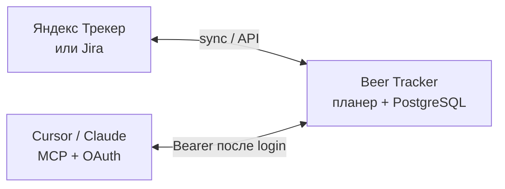

<h1 align="center">
  <picture>
    <source media="(prefers-color-scheme: dark)" srcset="./docs/media/logo-button-dark.svg" />
    <source media="(prefers-color-scheme: light)" srcset="./docs/media/logo-button-light.svg" />
    
  </picture>
</h1>

<p align="center">
  <strong>Умный планер спринтов поверх Яндекс Трекера и Jira</strong><br />
  Свимлейны по людям и дням, бэклог, цели, burndown — без замены вашего трекера.
</p>

<p align="center">
  <a href="./LICENSE"></a>
  <a href="https://hub.docker.com/r/dinkimom/beer-tracker"></a>
  <a href="./CHANGELOG.md"></a>
</p>

<p align="center">
  <a href="#зачем">Зачем</a> ·
  <a href="#возможности">Возможности</a> ·
  <a href="#планер">Планер</a> ·
  <a href="#бэклог">Бэклог</a> ·
  <a href="#burndown">Burndown</a> ·
  <a href="#выгрузка-факта">Факт</a> ·
  <a href="#ретро">Ретро</a> ·
  <a href="#совместная-работа">Совместная работа</a> ·
  <a href="#mcp-для-агентов">MCP</a> ·
  <a href="#быстрый-старт">Старт</a> ·
  <a href="#документация">Docs</a>
</p>

---

<p align="center">
  <picture>
    <source media="(prefers-color-scheme: dark)" srcset="./docs/media/swimlane-dark.png" />
    <source media="(prefers-color-scheme: light)" srcset="./docs/media/swimlane-light.png" />
    
  </picture>
</p>

## Зачем

Задачи, статусы и спринты остаются в **Яндекс Трекере** или **Jira**. Beer Tracker даёт то, чего не хватает в самом трекере: **визуальный план на 10 рабочих дней** — кто чем занят утром, днём и вечером, с DnD и сохранением позиций. Плюс выгрузка **факта** из трекера, **ретро** спринта и **совместная работа** на одной доске в реальном времени.

| Кто | Что получает |
|-----|----------------|
| Разработка / QA | План по дням и людям, загрузка, перенос из бэклога |
| Тимлиды / PM | Цели, метрики, burndown, ретро с договорённостями |
| Вся команда | Presence и live-обновления, пока планируете вместе |
| Админы | Организации, команды, sync / выгрузка снимков и changelog |

Self-hosted, [Apache License 2.0](./LICENSE). Историческое имя UI — Sprint Manager. Провайдер трекера — на организацию: [Issue trackers](./docs/ISSUE_TRACKERS.md).

## Возможности

- **Свимлейны** — дорожка на человека, сетка 10×3 (утро / день / вечер), DnD и resize карточек
- **Бэклог** — отбор, фильтры, перенос задач в спринт
- **Цели и burndown** — чеклисты Delivery / Discovery и график выгорания SP/TP
- **Выгрузка факта** — changelog из трекера → таймлайн фактических фаз на свимлейне
- **Ретро** — доска ретроспективы, метрики спринта, договорённости в следующий спринт
- **Совместная работа** — presence-аватары, live-обновления доски, блокировка чужих жестов
- **Связи и стикеры** — стрелки между задачами, комментарии на таймлайне
- **MCP для агентов** — Cursor / Claude читают план и предлагают правки по OAuth 2.1

Подробный каталог — [CAPABILITIES.md](./docs/CAPABILITIES.md). Обзор продукта — [PROJECT_OVERVIEW.md](./docs/PROJECT_OVERVIEW.md).

> Планировщик эпиков и квартальный план сняты с навигации и не развиваются. См. [product steering](./docs/steering/product.md).

## Планер

Сетка спринта: **10 рабочих дней × 3 части дня**, отдельная дорожка на разработчика и тестировщика. Карточки тянутся мышкой, длительность меняется resize’ом, позиции и сегменты фаз сохраняются в PostgreSQL. Сбоку — задачи спринта, бэклог, цели, метрики и SLA-баги.

Живой кадр — в шапке README (`/demo/planner`). Светлая/тёмная версия скрина подстраивается под тему GitHub.

## Бэклог

Отбор задач вне спринта, фильтры по статусу и людям, перенос в активный спринт. Снимок с `/demo/planner` → вкладка Backlog.

<p align="center">
  <picture>
    <source media="(prefers-color-scheme: dark)" srcset="./docs/media/backlog-dark.png" />
    <source media="(prefers-color-scheme: light)" srcset="./docs/media/backlog-light.png" />
    
  </picture>
</p>

## Burndown

График выгорания Story Points и Test Points по дням спринта, с идеальной линией и маркером «сегодня».

<p align="center">
  <picture>
    <source media="(prefers-color-scheme: dark)" srcset="./docs/media/burndown-dark.png" />
    <source media="(prefers-color-scheme: light)" srcset="./docs/media/burndown-light.png" />
    
  </picture>
</p>

## Выгрузка факта

Фоновый sync подтягивает из трекера не только снимки задач, но и **историю статусов** (changelog). По ней на свимлейне строится **таймлайн факта**: когда задача была в работе, на ревью, в тесте — рядом с планом, а не вместо него.

Настраивают и запускают выгрузку админы в `/admin/sync` (очереди команд + доп. параметры). Для планового incremental sync нужны Redis и `pnpm sync-worker`; полный rescan можно гонять inline — см. [INSTALL.md](./docs/INSTALL.md).

<p align="center">
  <picture>
    <source media="(prefers-color-scheme: dark)" srcset="./docs/media/fact-timeline-dark.png" />
    <source media="(prefers-color-scheme: light)" srcset="./docs/media/fact-timeline-light.png" />
    
  </picture>
</p>

## Ретро

Отдельный режим ретроспективы спринта: колонки, заметки, картинки, комментарии и реакции. Сбоку блок **«Факты»** — состав спринта (закрыто / добавили / отказались / перенос), cycle time, узкие места по выгруженному changelog. Сформированные **договорённости** в процессе ретро переносятся в следующий спринт, чтобы ритуал не заканчивалось разговором.

<p align="center">
  <picture>
    <source media="(prefers-color-scheme: dark)" srcset="./docs/media/retro-dark.png" />
    <source media="(prefers-color-scheme: light)" srcset="./docs/media/retro-light.png" />
    
  </picture>
</p>

## Совместная работа

Несколько человек на одном спринте видят **кто сейчас на доске**: аватары в шапке и на карточках, действие (смотрит / двигает / редактирует / меняет продолжительность). Чужой жест **блокирует** карточку; правки позиций, задач, связей, комментариев и ретро приходят по SSE без ручного обновления. Есть общий **таймер спринта**. Работает на свимлейнах, канбане и ретро.

Для нескольких инстансов приложения нужен Redis (pub/sub + presence); без него realtime живёт в памяти одного процесса.

<p align="center">
  <picture>
    <source media="(prefers-color-scheme: dark)" srcset="./docs/media/collaboration-dark.png" />
    <source media="(prefers-color-scheme: light)" srcset="./docs/media/collaboration-light.png" />
    
  </picture>
</p>

## Как это работает



1. Подключаете организацию к трекеру (Yandex / Jira Cloud / Jira DC).
2. Пользователи входят со своей учёткой трекера.
3. Спринты и задачи подтягиваются в планер; позиции и планы живут в PostgreSQL.
4. Sync выгружает снимки и changelog → факт на свимлейне и метрики ретро.
5. Несколько вкладок/коллег делят доску через realtime (presence + live updates).
6. Агенты подключаются к `/api/mcp` по OAuth 2.1 — без shared secret в конфиге.

Стек: Next.js 16, React 19, PostgreSQL, опционально Redis + BullMQ (sync-воркер и multi-instance realtime).

## MCP для агентов

Remote MCP крутится **на вашем инстансе** Beer Tracker. Клиент (Cursor, Claude Desktop / Code) открывает браузер → логин и consent → получает Bearer. Scope: `mcp:tools`. Подробности и URL — [SPRINT_CONTEXT.md](./docs/SPRINT_CONTEXT.md).

**Что умеет агент**

- Найти спринт по имени (`search_sprints`) и снять **planning graph**: позиции, capacity, цели, заметки, связи (`get_sprint_context` / `get_sprint_capacity`)
- Поискать задачи и людей (`search_issues`, `resolve_person`), открыть issue / snapshot
- **Предложить** правки плана (`propose_plan_patch`) и **применить** только после confirm (`apply_plan_patch`) — не silent write
- Читать и править доску ретро (`get_retro_board` / `apply_retro_board`)

**Кейсы**

| Кейс | Как это выглядит |
|------|------------------|
| «Какие есть риски в планировании спринта Demo 2615?» | Агент ищет спринт → capacity / overlaps → коротко объясняет перегруз |
| Запланируй DEMO-101 на Алису | Propose позиции и заметок → человек смотрит preview → apply |
| «Подготовь ретро по спринту Demo 2614» | Сводка фактов + черновик карточек на доске ретро |
| Планирование в IDE | Тот же graph, что на свимлейне, без скринов и без клона репо |

В конфиге достаточно URL:

```json
{
  "mcpServers": {
    "beer-tracker-planning": {
      "url": "https://<your-bt-host>/api/mcp"
    }
  }
}
```

## Быстрый старт

```bash
cp env.example .env
# POSTGRES_PASSWORD, AUTH_SESSION_SECRET (≥32), ORG_SECRETS_ENCRYPTION_KEY (64 hex)
docker compose -f docker-compose.yml -f docker-compose.hub.yml up -d
```

Откройте [http://localhost:3000](http://localhost:3000). Образы этого релиза — [`dinkimom/beer-tracker`](https://hub.docker.com/r/dinkimom/beer-tracker), тег `1.16.7`.

Полная установка (исходники, S3, трекер, sync, CI) — **[docs/INSTALL.md](./docs/INSTALL.md)**.  
Настройка провайдера — **[docs/ISSUE_TRACKERS.md](./docs/ISSUE_TRACKERS.md)**.

## Документация

| Документ | О чём |
|----------|--------|
| [Установка](./docs/INSTALL.md) | Docker, dev, env, sync, команды |
| [Обзор проекта](./docs/PROJECT_OVERVIEW.md) | Что это, для кого, экраны |
| [Issue trackers](./docs/ISSUE_TRACKERS.md) | Yandex Tracker и Jira |
| [Возможности](./docs/CAPABILITIES.md) | Расширенный список функций |
| [Медиа для README](./docs/media/README.md) | Слоты скринов / GIF |
| [Индекс docs](./docs/DOCUMENTATION_INDEX.md) | Навигация по всей документации |
| [API](./docs/API_DOCUMENTATION.md) | HTTP API |
| [Sprint context / MCP](./docs/SPRINT_CONTEXT.md) | Planning graph и ретро для агентов |
| [Архитектура](./ARCHITECTURE.md) | Данные, слои, паттерны клиента |

## Контрибьюция

Коммиты с [DCO](https://developercertificate.org/) (`git commit -s`) — см. [CONTRIBUTING.md](./CONTRIBUTING.md).  
Уязвимости — [SECURITY.md](./SECURITY.md).

## Лицензия

[Apache License 2.0](./LICENSE). Атрибуция — [NOTICE](./NOTICE).
