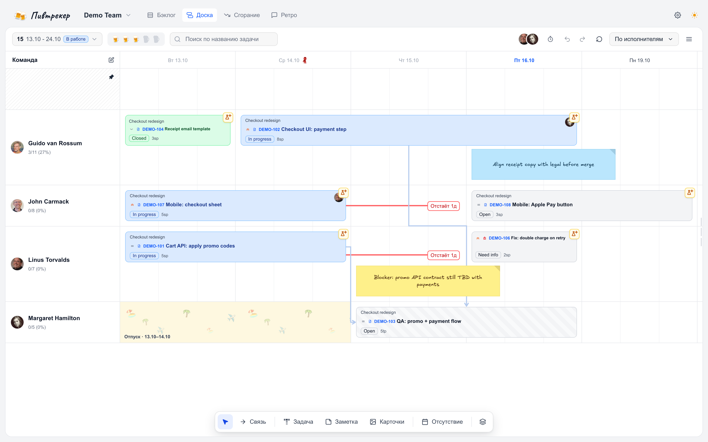
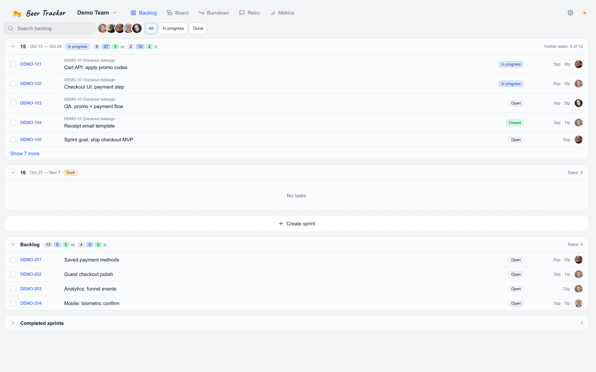
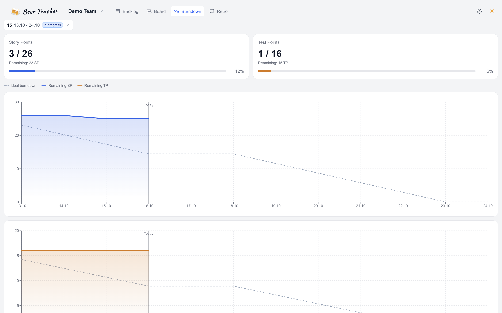
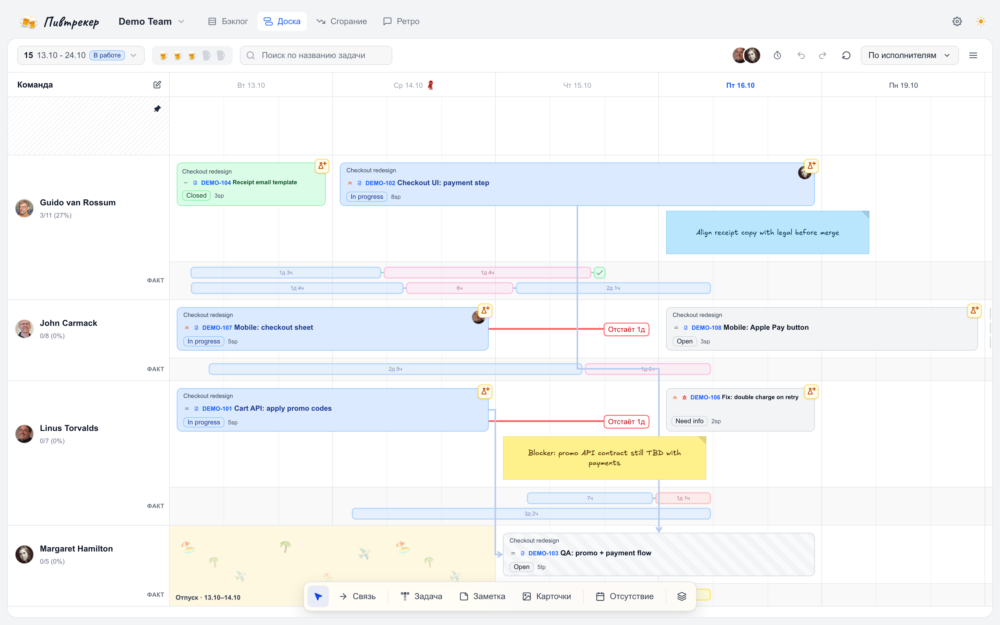
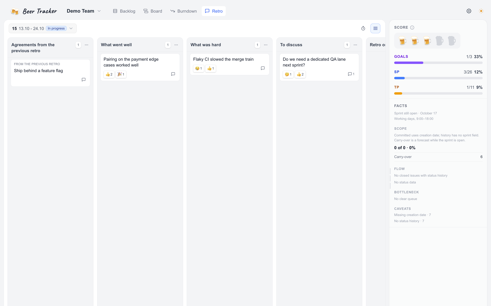
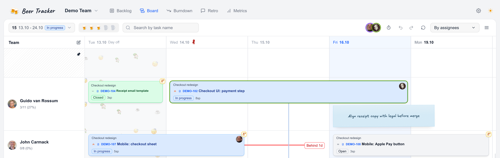

<h1 align="center">
  <picture>
    <source media="(prefers-color-scheme: dark)" srcset="./docs/media/logo-button-dark.png" />
    <source media="(prefers-color-scheme: light)" srcset="./docs/media/logo-button-light.png" />
    
  </picture>
</h1>

<p align="center">
  <strong>Русский</strong> · <a href="./README.en.md">English</a>
</p>

<p align="center">
  <strong>Планер спринтов для Яндекс Трекера и Jira</strong><br />
  Раскладывает задачи по людям и дням, ведёт бэклог, цели и burndown. Сами задачи остаются в трекере.
</p>

<p align="center">
  <a href="./LICENSE"></a>
  <a href="https://hub.docker.com/r/dinkimom/beer-tracker"></a>
  <a href="./CHANGELOG.md"></a>
</p>

<p align="center">
  <a href="#планер">Планер</a> ·
  <a href="#бэклог">Бэклог</a> ·
  <a href="#burndown">Burndown</a> ·
  <a href="#факт">Факт</a> ·
  <a href="#ретро">Ретро</a> ·
  <a href="#совместная-работа">Совместная работа</a> ·
  <a href="#где-используется">Где используется</a> ·
  <a href="#быстрый-старт">Старт</a> ·
  <a href="#mcp-для-агентов">MCP</a>
</p>

## Планер

Сетка строится по рабочим дням спринта из трекера. День делится на 2, 3 или 4 слота, по умолчанию на три. У каждого разработчика и тестировщика своя дорожка.

Карточку можно перетащить мышкой, а длительность поменять, потянув за край. Отпуска и техспринты видны на тех же дорожках. По ходу спринта на доску можно клеить заметки, чтобы ничего не забыть: в них работают ссылки, чеклисты и реакции. Справа список задач спринта.

<p align="center">
  <picture>
    <source media="(prefers-color-scheme: dark)" srcset="./docs/media/swimlane-dark.png" />
    <source media="(prefers-color-scheme: light)" srcset="./docs/media/swimlane-light.png" />
    
  </picture>
</p>

## Бэклог

Задачи вне спринта: фильтры по статусу и исполнителям, перенос в активный спринт.

<p align="center">
  <picture>
    <source media="(prefers-color-scheme: dark)" srcset="./docs/media/backlog-dark.png" />
    <source media="(prefers-color-scheme: light)" srcset="./docs/media/backlog-light.png" />
    
  </picture>
</p>

## Burndown

Story Points и Test Points по дням спринта, идеальная линия и отметка текущего дня.

<p align="center">
  <picture>
    <source media="(prefers-color-scheme: dark)" srcset="./docs/media/burndown-dark.png" />
    <source media="(prefers-color-scheme: light)" srcset="./docs/media/burndown-light.png" />
    
  </picture>
</p>

## Факт

Sync забирает из трекера историю статусов, и на свимлейне появляется **таймлайн факта**: когда задача была в работе, на ревью и в тесте. Он рисуется рядом с планом и не заменяет его.

Синхронизация запускается из `/admin/sync`. Для инкрементального sync по расписанию нужны Redis и `pnpm sync-worker`, полный rescan работает и без воркера. Подробнее в [INSTALL.md](./docs/INSTALL.md).

<p align="center">
  <picture>
    <source media="(prefers-color-scheme: dark)" srcset="./docs/media/fact-timeline-dark.png" />
    <source media="(prefers-color-scheme: light)" srcset="./docs/media/fact-timeline-light.png" />
    
  </picture>
</p>

## Ретро

Колонки, заметки, картинки, комментарии и реакции. В боковой панели **«Факты»** видно, что закрыли, добавили, сняли и перенесли, а ещё cycle time и узкие места по changelog. Договорённости с ретро переезжают в следующий спринт.

<p align="center">
  <picture>
    <source media="(prefers-color-scheme: dark)" srcset="./docs/media/retro-dark.png" />
    <source media="(prefers-color-scheme: light)" srcset="./docs/media/retro-light.png" />
    
  </picture>
</p>

## Совместная работа

Когда в спринте работают несколько человек, видно, кто сейчас на доске и что делает: аватары в шапке и на карточках, рядом действие (смотрит, двигает, редактирует, меняет длительность). Пока кто-то тащит карточку, у остальных она заблокирована. Позиции, задачи, связи, комментарии и ретро обновляются без перезагрузки страницы. Есть общий таймер спринта.

Если инстансов несколько, нужен Redis. Без него realtime работает только внутри одного процесса.

<p align="center">
  <picture>
    <source media="(prefers-color-scheme: dark)" srcset="./docs/media/collaboration-dark.png" />
    <source media="(prefers-color-scheme: light)" srcset="./docs/media/collaboration-light.png" />
    
  </picture>
</p>

## Где используется

Компании, которые планируют спринты в Beer Tracker.

<!-- adopters: тот же порядок, что в docs/companies.md. Пара файлов docs/media/companies/<id>-light.svg и <id>-dark.svg. -->
<p align="center">
  <a href="https://www.yclients.com">
    <picture>
      <source media="(prefers-color-scheme: dark)" srcset="./docs/media/companies/yclients-dark.svg" />
      <source media="(prefers-color-scheme: light)" srcset="./docs/media/companies/yclients-light.svg" />
      
    </picture>
  </a>
</p>

## Быстрый старт

```bash
cp env.example .env
# POSTGRES_PASSWORD, AUTH_SESSION_SECRET (≥32), ORG_SECRETS_ENCRYPTION_KEY (64 hex)
docker compose -f docker-compose.yml -f docker-compose.hub.yml up -d
```

Откройте [http://localhost:3000](http://localhost:3000) и подключите трекер. Образы лежат на Docker Hub: [`dinkimom/beer-tracker`](https://hub.docker.com/r/dinkimom/beer-tracker), тег `1.25.1`.

Установка, S3, sync и запуск из исходников описаны в [docs/INSTALL.md](./docs/INSTALL.md), выбор трекера для организации — в [docs/ISSUE_TRACKERS.md](./docs/ISSUE_TRACKERS.md).

## MCP для агентов

MCP-сервер работает на вашем же инстансе. Клиент (Cursor, Claude Desktop или Claude Code) открывает браузер, вы входите и подтверждаете доступ, после чего клиент получает Bearer-токен со scope `mcp:tools`. Подробнее в [SPRINT_CONTEXT.md](./docs/SPRINT_CONTEXT.md).

Агент читает план и предлагает правки, но в спринт они попадают только после вашего подтверждения. Что он умеет:

- найти спринт (`search_sprints`) и получить planning graph: позиции, capacity, цели, заметки, связи (`get_sprint_context`, `get_sprint_capacity`);
- найти задачи и людей (`search_issues`, `resolve_person`), открыть задачу и её snapshot;
- предложить правки (`propose_plan_patch`) и применить их (`apply_plan_patch`);
- читать и править доску ретро (`get_retro_board`, `apply_retro_board`).

| Запрос | Что происходит |
|--------|----------------|
| «Какие риски в спринте Demo 2615?» | Агент смотрит capacity и пересечения и коротко пишет, кто перегружен |
| «Запланируй DEMO-101 на Алису» | Агент предлагает позиции и заметки, человек смотрит превью и применяет |
| «Подготовь ретро по Demo 2614» | Агент собирает факты спринта и раскладывает черновые карточки на доске |

```json
{
  "mcpServers": {
    "beer-tracker-planning": {
      "url": "https://<your-bt-host>/api/mcp"
    }
  }
}
```

## Документация

| Документ | О чём |
|----------|--------|
| [Установка](./docs/INSTALL.md) | Docker, dev, env, sync |
| [Issue trackers](./docs/ISSUE_TRACKERS.md) | Яндекс Трекер и Jira |
| [Возможности](./docs/CAPABILITIES.md) | Полный список функций |
| [Обзор](./docs/PROJECT_OVERVIEW.md) | Для кого продукт и какие в нём экраны |
| [Sprint context / MCP](./docs/SPRINT_CONTEXT.md) | Planning graph и ретро для агентов |
| [Индекс](./docs/DOCUMENTATION_INDEX.md) | Вся документация |

## Участие в разработке

Коммиты подписываются по [DCO](https://developercertificate.org/) (`git commit -s`), правила в [CONTRIBUTING.md](./CONTRIBUTING.md). Об уязвимостях сообщайте по [SECURITY.md](./SECURITY.md).

В коде и старых документах интерфейс может называться Sprint Manager, это прежнее имя. Стек и слои описаны в [ARCHITECTURE.md](./ARCHITECTURE.md), слоты для скриншотов — в [docs/media/README.md](./docs/media/README.md). Как добавить компанию в «Где используется», написано в [docs/companies.md](./docs/companies.md).

Планировщик эпиков и квартальный план из продукта убраны, причины в [product steering](./docs/steering/product.md).

## Лицензия

[Apache License 2.0](./LICENSE), атрибуция в [NOTICE](./NOTICE).
